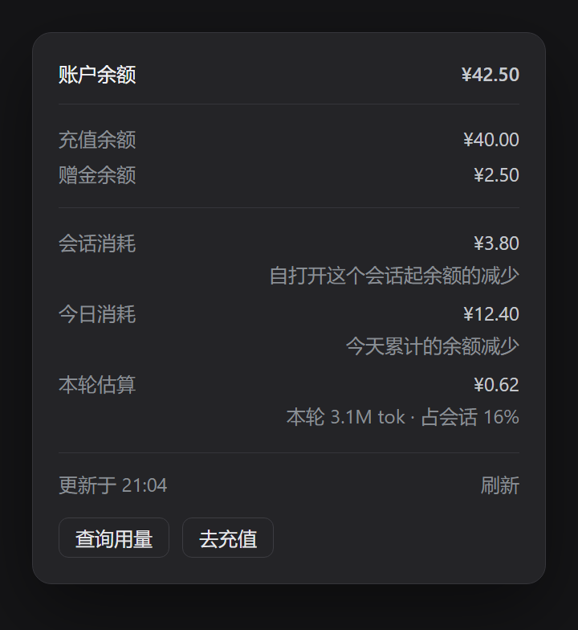

# dsh-plugin-account-balance

给 [DeepSeek Harness](https://github.com/deepseek-ai/deepseek-harness)（DSH）的会话输入框下面加一条余额统计：
**余额 · 会话消耗 · 本轮估算**，点一下展开明细面板。




> 截图是示意图，数字为虚构值。

## 功能

- **余额**：`ctx.remote.account.getBalance`，与「设置 → 账号与余额」同一个 Host 接口，金额为充值余额 + 赠金余额的合计。
- **会话**：这个会话累计消耗，按「余额相对打开本会话时的减少量」计算；基线按 sessionId 存在 `localStorage`，切换会话、刷新窗口都不串不清零，充值会把基线抬高，不会出现负数。
- **今日**：按本地日历日累计的余额减少；每次观察累加下降量，充值只移动参照点，不会抹掉当天已花的；跨零点自动归零。
- **本轮**：本轮 token ÷ 全会话 token × 会话消耗。Host 没有逐轮账单，这一项是分摊估算；分母用全日志的 `tokenUsage` 投影，翻页和压缩都不会让比例跑偏。
- **低余额变红**：低于 5（`LOW_BALANCE_CENTS = 500`，按各币种最小单位，即 ¥5 / $5）时「余额」那一段变红，用的是 DSH 自己的 `--dsw-alias-state-error-primary`。
- **点击面板**：真 `<button>` + portal，Escape / 点面板外 / 再点一次关闭；面板里能刷新，并跳到「查询用量 / 去充值」（链接与设置页同源）。
- 未登录、接口失败或没有钱包时整条隐藏，不留空占位。

## 安装

### 方式一：插件页

仓库地址：<https://github.com/mantou2nd/dsh-plugin-account-balance>（发版后 Releases 里也有打包好的 `.tgz`）。

1. 下载 `dsh-plugin-account-balance-1.0.0.tgz`（或直接 `git clone` 本仓库）。
2. DSH → 侧栏 **插件** → **添加插件** → 选这个包 / 本地目录。
3. 安装完成后点 **立即启用**，刷新一次窗口。

### 方式二：命令行

```bash
node install.mjs                   # 装到 ~/.dsh/profiles/desktop
node install.mjs --profile web     # 装到指定 profile
node install.mjs --uninstall       # 卸载
```

脚本会把包复制进 profile 的 `node_modules`，把包名写进 `dsh.profile.bundles`，
并清掉早期手工安装留在 `cordis.patch.yml` 里的那一行（避免同一入口装两次）。

> 两种方式不要叠加：包已经在 `dsh.profile.bundles` 里后，就不要再往 `cordis.patch.yml` 加 `ui-account-balance` 行。

## 配置

| 想改什么 | 改哪里 |
| --- | --- |
| 变红的阈值 | `lib/client.js` 的 `LOW_BALANCE_CENTS`（500 = ¥5） |
| 刷新频率 | `lib/client.js` 的 `REFRESH_MS`（默认 60000） |
| 文案 | `lib/client.js` 里的 `t("中文", "English")` |
| 上报的客户端版本 | `lib/client.js` 的 `CLIENT_VERSION` |

改完跑一次 `node install.mjs`，再刷新窗口（profile 配置会热加载，但浏览器 bundle 不会自己热更）。
不想刷新可以在插件页把这一项关掉再打开，让条目重新挂载。

## 开发

```bash
node test/client.test.mjs     # 11 项单测：注册、渲染、面板、金额格式化、低余额、未登录降级
```

结构：

| 路径 | 作用 |
| --- | --- |
| `package.json` | `dsh.bundle.patch`（bundle 层）+ `dsh.client`（web 客户端半侧） |
| `cordis.patch.yml` | bundle 层插入 `ui-account-balance` 行 |
| `lib/index.js` | Host 半侧，无行为 |
| `lib/client.js` | 浏览器 bundle：注册 `conversation.composer.dock` 条目、读余额、算会话/本轮、渲染面板 |
| `test/client.test.mjs` | 用 Node 跑的最小渲染测试 |
| `install.mjs` | 命令行安装/卸载 |

## 兼容性

在 DSH `0.2.1-rc.2`（桌面版）上验证。插件依赖 `remote.account` 服务，只对 DeepSeek 账号模式生效。
包里硬编码了 `CLIENT_VERSION`；如果 DSH 大版本变化后连「设置 → 账号与余额」都打不开，把它改成对应版本再试。

## Known limitations

- 「会话」是余额差，不是账单：同一时间跑的其它会话、后台任务、子智能体的消耗也算在当前这条里。
- 「本轮」按 token 占比分摊：cache 命中、未缓存输入、输出单价不同，均摊会抹平差异，适合看量级不适合对账。
- 打开旧会话时基线从此刻起算，历史消耗不追溯。

## License

MIT
